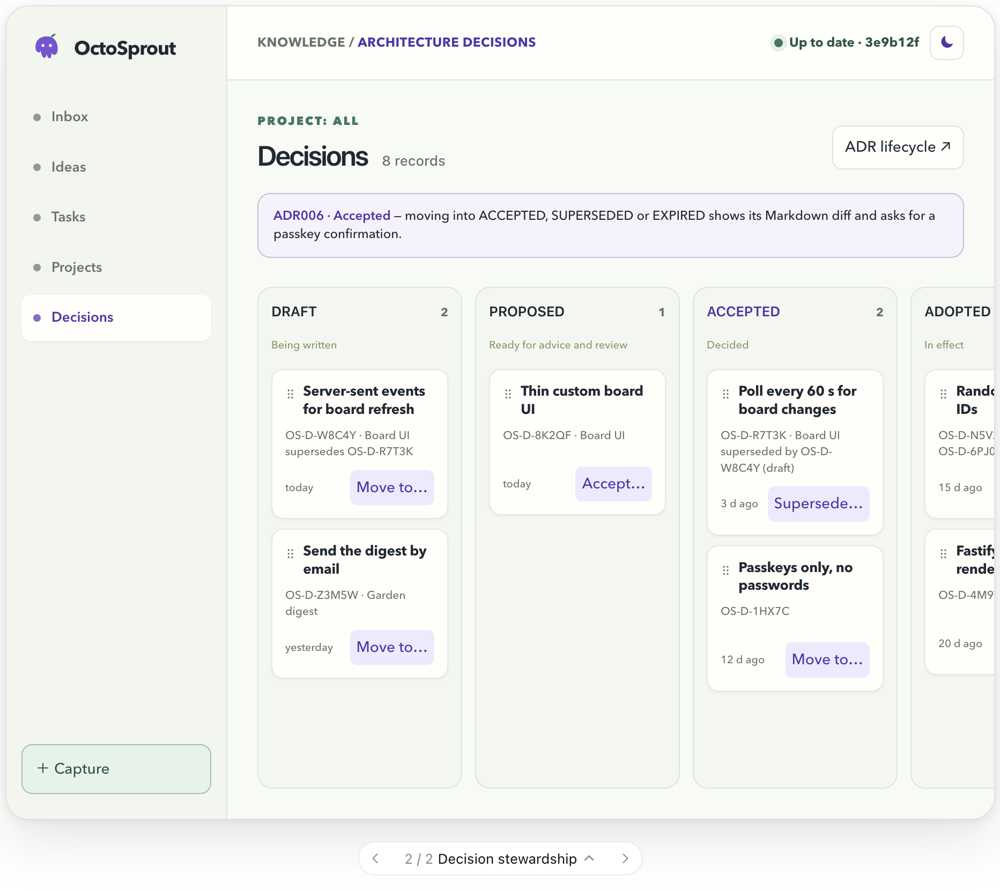
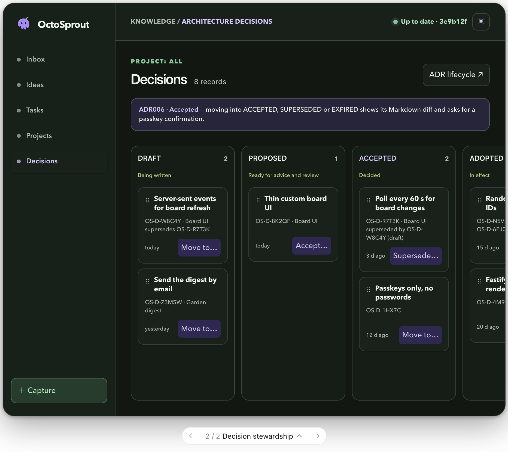
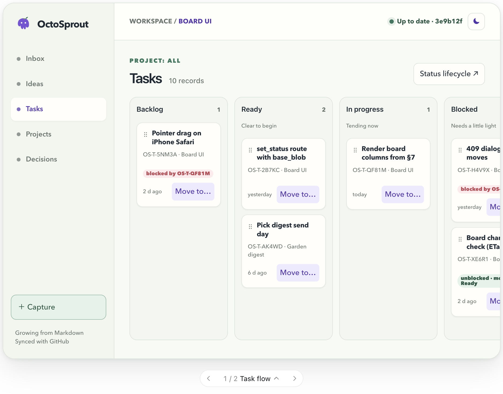
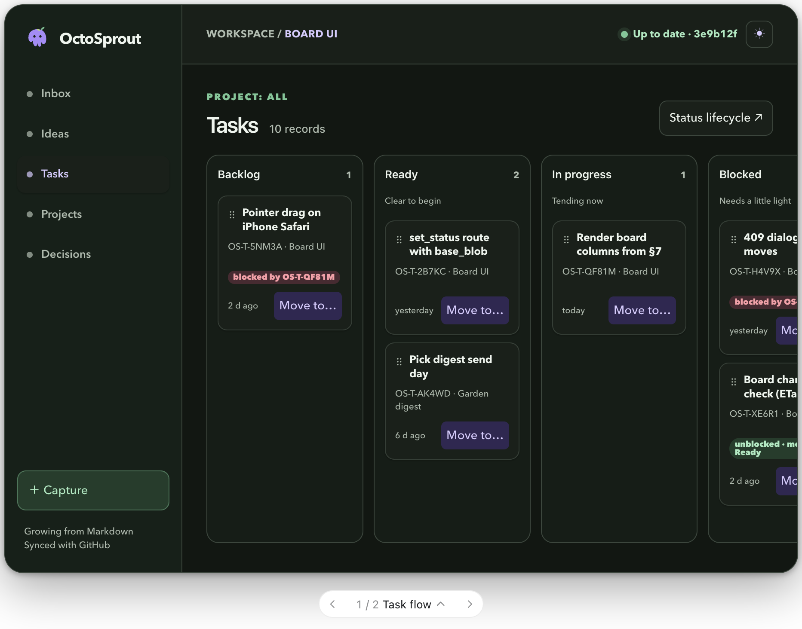

# OctoSprout UI design brief

The visual direction for the thin board UI decided in
[ADR006](../adr/0006-board-engine-and-frontend.md). The behaviour it builds on
is in [`boards.md`](boards.md) and the clickable
[`boards-mockup.html`](boards-mockup.html)
([artifact](https://claude.ai/artifact/6aUQPQhjWVHkQzbwAeHHfY)).

## Direction

A botanical workspace: quiet paper-and-moss surfaces, a purple octopus/sprout
mark, violet action states, and leaf-green syncing/status cues. The mockup
follows the thin, server-rendered board model of `boards.md` rather than
adding a generic dashboard.

## Structure

- Persistent navigation: Inbox, Ideas, Tasks, Projects, Decisions, Capture.
- Compact top bar: workspace context and page-level sync state.
- Status columns are the source of placement; cards sort by most recently
  updated.
- Terminal states are collapsed vertical strips by default.
- Tasks board: Backlog, Ready, In progress, Blocked, Done, Cancelled.
- Projects board: Proposed, Active, On hold, Completed, Archived.
- Decisions board: DRAFT, PROPOSED, ACCEPTED, ADOPTED, SUPERSEDED, EXPIRED.
- Ideas board: Seed, Sprouting, Ready, Dormant, Transplanted, Composted.

## Card anatomy and interactions

Cards contain a drag-only grip, linked title, record ID/project metadata,
updated time, and a native "Move to…" control. It must list only
lifecycle-valid destinations; drag targets should likewise dim or reject
invalid moves.

Use red `blocked by` chips for open dependency links and green `unblocked`
chips for released work. A blocker completing can offer a move such as
"Done (+1 unblocked)". Moves display Saving, committed SHA, pending, or a 409
conflict resolution state.

Terminal/approval-sensitive moves require a confirmation panel with the
resulting diff. Ready idea → Transplanted opens promotion; Active project →
Completed/Archived and decision moves into ACCEPTED, SUPERSEDED, or EXPIRED
require approval/passkey confirmation. SUPERSEDED should offer drafting a
replacement when no newer decision exists.

## Visual system

| Token | Light | Dark |
|---|---|---|
| Page (paper / forest) | `#F8FAF6` | `#111712` |
| Sidebar / panel | `#F1F6EE` | `#182019` |
| Action (violet / lavender) | `#7753D6` | `#A78BFA` |
| Sync and status (green) | `#34785D` | `#72C795` |

- Rounded, low-elevation cards; spacious columns; one restrained botanical cue
  per surface.
- Respect system appearance by default; the appearance control offers a
  deliberate preview override.

## Responsive behaviour

At phone width, retain the app shell, collapse navigation labels to icons,
preserve large tap targets, and horizontally scroll the status board. Drag
only from the grip; tapping the card title opens record detail. Native select
remains the keyboard, screen-reader, and mobile fallback.

## Mockups

Decisions board, light and dark:

Tasks board, light and dark:

## Differences from what is built or specified today

Points to settle when the boards are built; the brief is the target.

- **Navigation.** The Phase 1 pages use a top navigation bar
  (`ui/html.ts`); the brief moves to a persistent sidebar with Capture as a
  button. The Inbox, Capture and Settings pages change with it.
- **Colours.** `app.css` uses a single green accent (`#1f6b4f` light,
  `#5cc49a` dark) for actions. The brief makes actions violet and keeps green
  for sync and status. The PWA `theme-color` and the icons should follow.
- **Appearance override.** Phase 1 follows the system setting only. An
  override has to be remembered per browser (`localStorage`) and applied by
  `/static/*.js`, since the CSP allows no inline script.
- **"Done (+1 unblocked)".** This is not a consequential move in `boards.md`
  or spec §7.3: it commits directly, unless it touches more than
  `bulk_threshold` records (§9.2 item 5).
- **Fonts.** The mockups appear to use a rounded sans for display text. Any
  web font must be served from the app itself (`default-src 'self'`).
